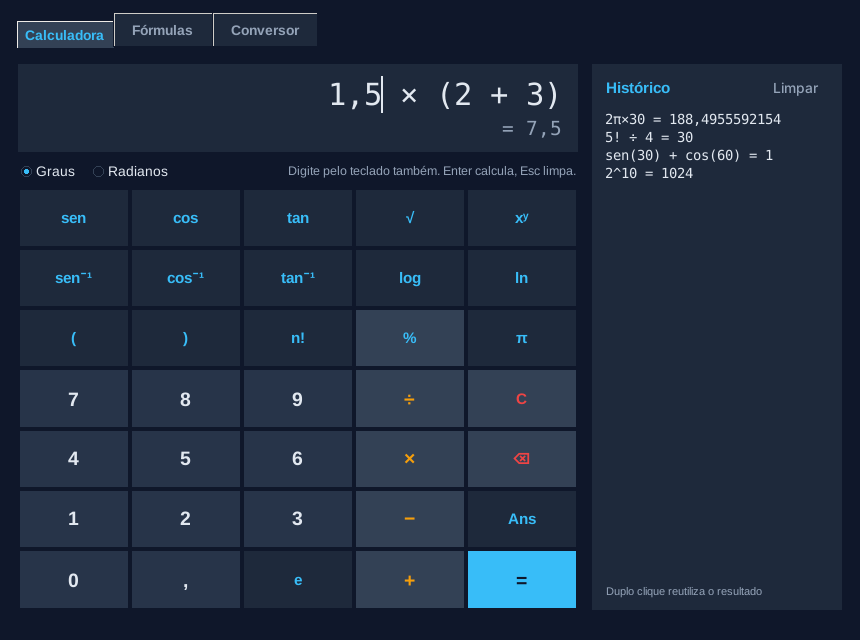
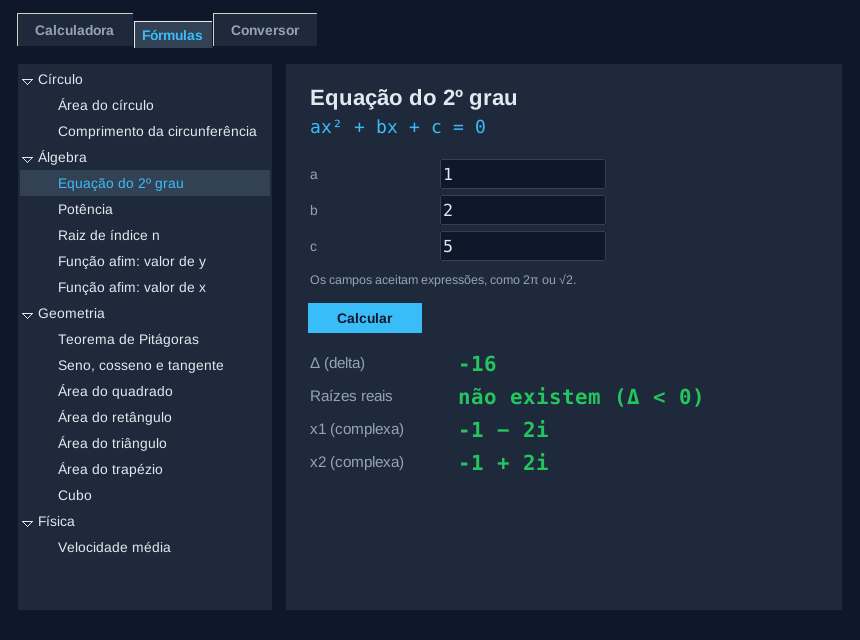
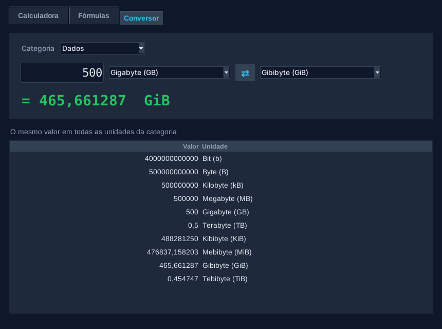

# Calculadora Científica

Calculadora com teclado científico, fórmulas prontas de matemática e física e conversor de unidades. Funciona no **Windows, Linux e macOS** e não precisa instalar nenhuma biblioteca: só Python.

| Calculadora | Fórmulas | Conversor |
|---|---|---|
|  |  |  |

## Funcionalidades

**Calculadora**
- Teclado científico: seno, cosseno, tangente e inversas, raiz, potência, log, ln, fatorial, porcentagem, π e *e*.
- Modo **graus** ou **radianos**.
- Escrita natural, no padrão brasileiro: `2,5 × 4`, `2π`, `√16`, `5!`, `200 × 15%`, `3sen(30)`.
- Prévia do resultado enquanto você digita, e **histórico** clicável (duplo clique reaproveita o resultado). A tecla **Ans** insere o último resultado.
- Teclado do computador: Enter calcula, Esc limpa.
- Mensagens claras para erros: divisão por zero, raiz de negativo, tangente de 90°, log de zero...

**Fórmulas**, as mesmas do menu da versão original:

| Grupo | Fórmulas |
|---|---|
| Círculo | área, comprimento da circunferência |
| Álgebra | equação do 2º grau (inclusive raízes complexas), potência, raiz de índice n, função afim (valor de y ou de x) |
| Geometria | teorema de Pitágoras (descobre o lado que falta), seno/cosseno/tangente no triângulo retângulo, áreas do quadrado, retângulo, triângulo e trapézio, área e volume do cubo |
| Física | velocidade média (km/h e m/s) |

Os campos aceitam expressões, como `2π` ou `√2`.

**Conversor de unidades**, com seis categorias:

| Categoria | Unidades |
|---|---|
| Comprimento | km, m, cm, mm, milha, pé, polegada |
| Área | km², hectare, m², cm², mm², alqueire paulista |
| Volume | m³, litro, mL, cm³, galão |
| Massa | tonelada, kg, g, mg, libra, onça |
| Dados | bit, byte, kB/MB/GB/TB (base 1000) e KiB/MiB/GiB/TiB (base 1024) |
| Temperatura | Celsius, Fahrenheit, Kelvin (com verificação do zero absoluto) |

Além do resultado, mostra o mesmo valor em todas as unidades da categoria. É útil, por exemplo, para entender por que um HD de 500 GB aparece como 465 GiB no Windows.

## Segurança: sem `eval()`

A expressão digitada nunca é executada como código Python. O módulo `expressao.py` converte o texto numa árvore sintática (`ast`) e só aceita números, operadores aritméticos, constantes e as funções da lista permitida. Qualquer outra coisa, como `__import__('os')`, é rejeitada. Também há limites para expoentes e fatoriais gigantes, que poderiam travar o programa.

## Requisitos

- Python 3.9 ou mais novo, com Tkinter (já vem no instalador oficial do Windows e do macOS).
  - No Ubuntu/Debian, se faltar: `sudo apt install python3-tk`

## Como usar

```bash
git clone https://github.com/thi-araujo/Calculadora_Cientifica.git
cd Calculadora_Cientifica
python calculadora.py
```

No Linux/macOS, use `python3` no lugar de `python`.

## Estrutura do projeto

```
Calculadora_Cientifica/
├── calculadora.py          # interface gráfica (Tkinter)
├── expressao.py            # avaliador seguro de expressões e formatação brasileira
├── formulas.py             # fórmulas de matemática e física
├── conversor.py            # conversão de unidades
├── tests/
│   └── test_calculadora.py # testes automatizados
└── docs/                   # capturas de tela usadas neste README
```

## Testes

```bash
python -m unittest discover -s tests -v
```

Os testes conferem os cálculos, os erros esperados, a tentativa de executar código pela calculadora e a ida e volta de todas as conversões.

## Histórico

A primeira versão (setembro de 2022) era um programa de terminal com cerca de 1000 linhas e um menu de opções. Os números do menu não batiam com as opções do código, e cada conversão era um bloco repetido. Em 2026 a calculadora foi refeita com interface gráfica, avaliador de expressões, fórmulas e conversões organizadas em dados, e testes, mantendo todas as funções da versão original.

## Autor

**Thiago Gomes Araújo**: [GitHub](https://github.com/thi-araujo) · [Portfólio](https://thi-araujo.github.io)
